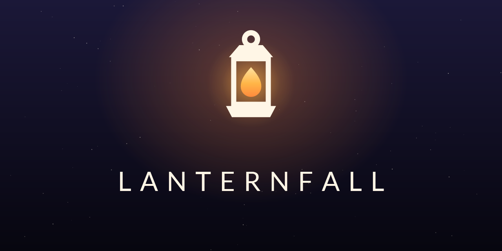

<p align="center">
  
</p>

<p align="center">
  <b>A calm, console-style fullscreen theme for <a href="https://playnite.link">Playnite</a>, with a web browser and YouTube built for the couch.</b><br>
  Everything works with a controller: no keyboard, no mouse.
</p>

<p align="center">
  <a href="#install">Install</a> ·
  <a href="#features">Features</a> ·
  <a href="docs/guide/README.md">Guide</a> ·
  <a href="#building-from-source">Build</a> ·
  <a href="#credits-and-license">Credits</a>
</p>

## Features

- **Spotlight.** One row for your cards and your games, with art, trailers, play time and achievements at a glance.
- **Browser.** A full web browser in a fullscreen overlay, driven entirely by the pad: the D-pad moves between links
  and buttons, the right stick drives a cursor, and an on-screen keyboard appears for every text field and the address
  bar. Bookmarks, recent pages, zoom, and video sites play in real fullscreen (Microsoft Edge WebView2).
- **YouTube.** A TV-style YouTube screen with no account and no ads: subscriptions, search with suggestions, history,
  playlists, channels and livestreams, and a player with quality up to 4K at 60 fps (AV1 where your graphics card
  decodes it), speed, captions and audio tracks. It can import your
  [FreeTube](https://freetubeapp.io) subscriptions, history and settings (read-only) and skips sponsor segments with
  [SponsorBlock](https://sponsor.ajay.app) when FreeTube has it on.
- **Profiles, store, captures, achievements and activity**, each a controller-friendly screen of its own.
- **23 color themes**, each with its own wallpaper, dark and light. Pick one per profile; every screen follows it.
- **A launch experience** that keeps the game's art on screen until the game is really there.

The Browser and YouTube are Spotlight cards: switch them off in **Settings → Spotlight** if you don't want them.

## Install

1. Download `Lanternfall.pthm`, `LanternfallCore.pext` and `LanternfallBrowser.pext` from the
   [latest release](../../releases/latest).
2. Open each file (or drag it onto Playnite) and confirm. Restart Playnite.
3. Fullscreen mode → **Menu → Playnite settings → Appearance → Theme → Lanternfall**.

Playnite 10 or newer, Windows 10 / 11, a controller recommended. The browser uses Microsoft Edge WebView2, which
Windows 10 / 11 already include.

**Updating.** Lanternfall offers new versions of the theme and Lanternfall Core from its menu when they move to a new
Selene version. Releases tagged with a suffix (like `1.5.7-3`) and Lanternfall Browser updates are installed by hand:
download the files the release notes name and open them as in step 2.

Found a problem or have an idea? Use **Menu → Report a problem**, or open an [issue](../../issues).

## Building from source

```powershell
tools\build.ps1        # Lanternfall Core, with the C# compiler that ships with Windows
Browser\build.ps1      # Lanternfall Browser
tools\package.ps1      # the three release files in dist\
```

A portable Playnite next to the repo (`..\Sandbox\Playnite`) is a safe place to try it without touching your own:
`tools\sandbox\deploy-to-sandbox.ps1`, then `tools\sandbox\start-sandbox.ps1`. Design notes for the Browser and
YouTube screens are in [docs/lanternfall](docs/lanternfall).

## Credits and license

The code is [MIT](LICENSE). Lanternfall is a fork of [Selene](https://github.com/mattxslv/Selene) by Matthew Silva,
built on [Playnite](https://github.com/JosefNemec/Playnite)'s fullscreen theme template. The Lanternfall name and lantern
mark are this project's own. Icons, sounds, wallpapers, palettes, avatars and the libraries the browser uses are
credited in [THIRD-PARTY-NOTICES.md](THIRD-PARTY-NOTICES.md). Lanternfall is not affiliated with YouTube, Google,
FreeTube or any console maker.
